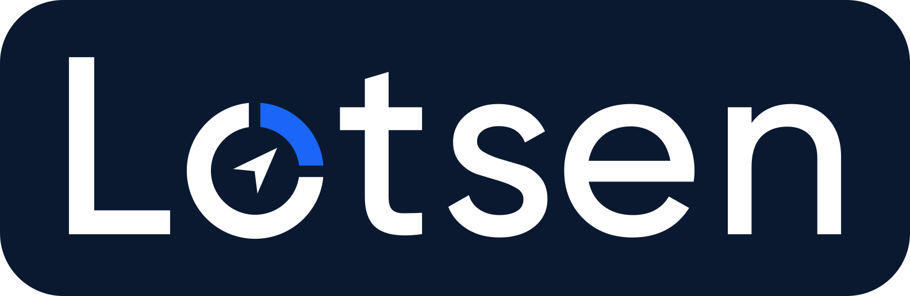
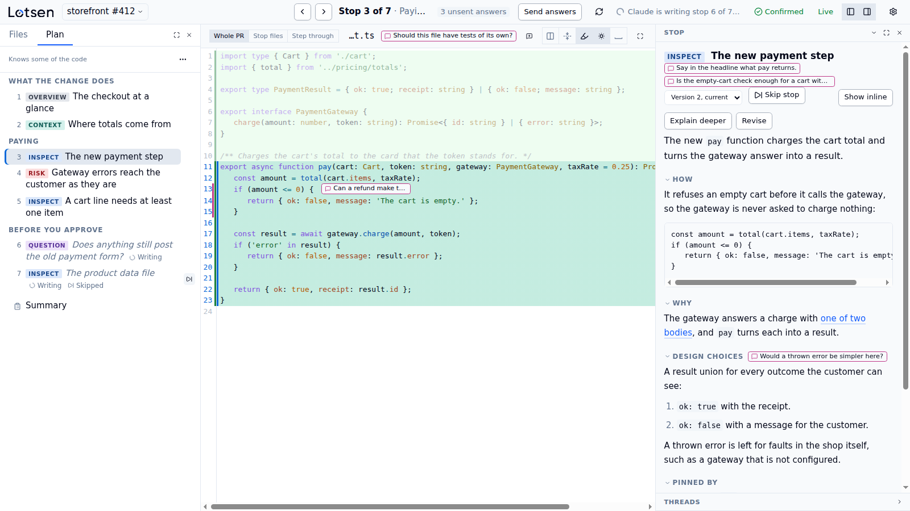

<h1 align="center">
  
</h1>

Lotsen layers a guided tour over an Azure DevOps pull request. Claude Code plans the tour and writes it stop by stop, and you read it in a local web UI, next to the code it talks about. You can ask Claude about any stop, answer the decisions it raises, and end with a summary of the review.

<picture>
  <source media="(prefers-color-scheme: dark)" srcset="docs/assets/tour-dark.png">
  
</picture>

## Why

A pull request shows its changes as a list of files, in the order of their paths. To review it, you first work out where to start, what each change is for and which parts carry the risk. Lotsen hands that work to Claude, which reads the pull request and its code, and leads you through it in an order that explains it:

- **A plan in chapters.** Each stop is an overview, context, a change to inspect, a risk or a question for you, and you can approve the plan before Claude writes any stop.
- **Stops that point at the code.** Each stop marks the lines it is about in the diff, and says how they work, why they are that way and what pins them down. You say how well you know the code, and Claude explains as much as you need.
- **Questions in place.** Ask Claude about a stop, a line or the whole tour, and the answer arrives in a thread beside the code. Answer the decisions that a stop asks of you, and send them to Claude together.
- **A summary at the end.** The last page collects your decisions, your concerns and the questions that stay open, and Claude can turn them into a synthesis of the review.

Everything stays on your machine. The UI runs on 127.0.0.1, Lotsen keeps its own clone of the repository, and it posts nothing to the pull request. A comment or a work item comes only from Claude's own tools, after you approve it in the terminal.

## Requirements

- [Claude Code](https://code.claude.com/docs/en/overview), allowed to use channels. On a Team or Enterprise plan, your organization has to enable them with `channelsEnabled`.
- git.
- [Node.js](https://nodejs.org/) 18 or later, with npm. Claude Code starts Lotsen through npx.
- The [Azure CLI](https://learn.microsoft.com/cli/azure/install-azure-cli), signed in with `az login` to an account that can read the pull request's repository.

## Limits

- **Azure DevOps Services only.** Lotsen tours pull requests at `dev.azure.com` or `<organization>.visualstudio.com`. It does not support Azure DevOps Server or any other hosting service for now.
- **Linux x64 and Windows x64.** On Linux it needs glibc, and WSL counts as Linux. Its npm packages hold no executable for any other system, such as macOS or Arm.
- **The channel needs a flag or an allowlist.** Your questions reach Claude through a Claude Code channel, and Lotsen is not on Anthropic's list of allowed channel plugins. You start Claude Code with a development flag, or your organization adds Lotsen to its own list, as [Start a tour](#start-a-tour) shows.
- **One reviewer per machine.** The UI serves only your own browser, on 127.0.0.1. A tour is a reading aid for you, not a review that your team shares.

## Install

Install the plugin, inside Claude Code:

```text
/plugin marketplace add lotsen-hq/plugins
/plugin install lotsen@lotsen-hq
```

The plugin is the whole install. Claude Code starts Lotsen with npx, which downloads the executable for your system from npm the first time each version starts.

For the [commands](#commands), also install Lotsen globally:

```sh
npm i -g lotsen
```

## Start a tour

Start Claude Code with Lotsen's channel, preferably in a checkout of the pull request's repository, so Claude can read the code with git:

```sh
claude --dangerously-load-development-channels plugin:lotsen@lotsen-hq
```

Claude Code asks you to confirm the flag. Choose "I am using this for local development". The startup screen then says that messages from `plugin:lotsen@lotsen-hq` inject directly in the session.

The channel is how your questions in the UI reach Claude. Without the flag, you can still read tours, but Claude does not get what you ask. An organization can list the plugin instead, with `{ "marketplace": "lotsen-hq", "plugin": "lotsen" }` in `allowedChannelPlugins`, and then you start with `--channels plugin:lotsen@lotsen-hq`. That setting replaces Anthropic's default list, so it also has to name the other channel plugins that people use.

Then ask for a tour:

```text
/lotsen:tour <pull-request-url> [familiar|some|new] [plan-first]
```

The second word says how well you know the code, and Claude asks if you leave it out. With `plan-first`, you approve the plan before Claude writes any stop. Claude opens the tour in your browser.

## Commands

Claude Code starts a background server when a session needs one, and it stops by itself once nothing uses it. These commands are for the times you want to step in. They need the global install from [Install](#install). Without it, run a command through npx with the plugin's version, such as `npx -y lotsen@0.2.0 open`, the form that Lotsen's errors in Claude Code name.

| Command | What it does |
|---|---|
| `lotsen open` | Opens the running server's UI in the browser. |
| `lotsen open --print-link` | Prints a fresh link to the running server's UI, which works once, and launches no browser, to open Lotsen in a browser that isn't the default. |
| `lotsen serve` | Runs the server in this terminal until Ctrl-C, to browse your tours with no Claude Code session. |
| `lotsen stop` | Stops the running server. |
| `lotsen restart` | Stops the running server and starts a background server of this executable. |

Tours are stored in `~/.local/share/lotsen` on Linux and in `%LOCALAPPDATA%\lotsen` on Windows.

## Update

Update the plugin:

```sh
claude plugin marketplace update lotsen-hq
claude plugin update lotsen@lotsen-hq
```

Restart Claude Code to use the new plugin. Its sessions start the new version through npx. A session replaces a background server of the old version that no session uses, but refuses one that another session still uses: close that session, or run `lotsen restart`. If you installed Lotsen globally, update it too, with `npm i -g lotsen`.

## Build from source

You need the .NET SDK that `global.json` names, Node.js (see `engines` in `ui/package.json`), [just](https://just.systems/), and for the Native AOT publish either clang and the zlib development files on Linux or the Visual Studio C++ build tools on Windows.

```sh
just ui-install
just publish    # the UI, then the executable
just check      # everything CI runs
just --list     # every recipe
```

- [`docs/live-test.md`](docs/live-test.md) shows how to tour a real pull request with your own build.
- [`docs/versioning.md`](docs/versioning.md) covers the version scheme and how to cut a release.
- [`ui/README.md`](ui/README.md) covers the web UI.

## Contributing

Bug reports, ideas and pull requests are welcome: [`CONTRIBUTING.md`](CONTRIBUTING.md) says how. Everyone who takes part follows the [code of conduct](CODE_OF_CONDUCT.md).

## License

Lotsen is licensed under the [Apache License, Version 2.0](LICENSE). The third-party notices are built into the executable, and Settings in the web UI links to them. The UI build writes them from the packages that it bundles, the Seti notices in [`ui/src/seti/`](ui/src/seti) and [`ui/third-party/notices.txt`](ui/third-party/notices.txt), which covers the .NET runtime and the NuGet packages.

Releases follow semantic versioning, as [`docs/versioning.md`](docs/versioning.md) describes.
